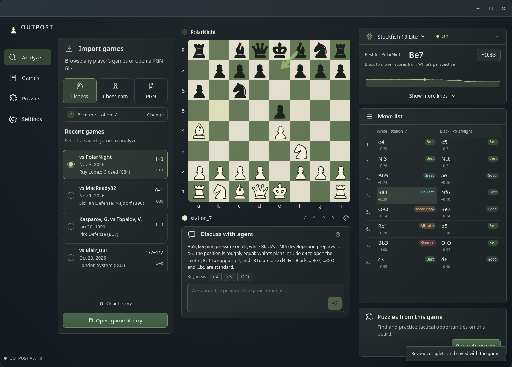
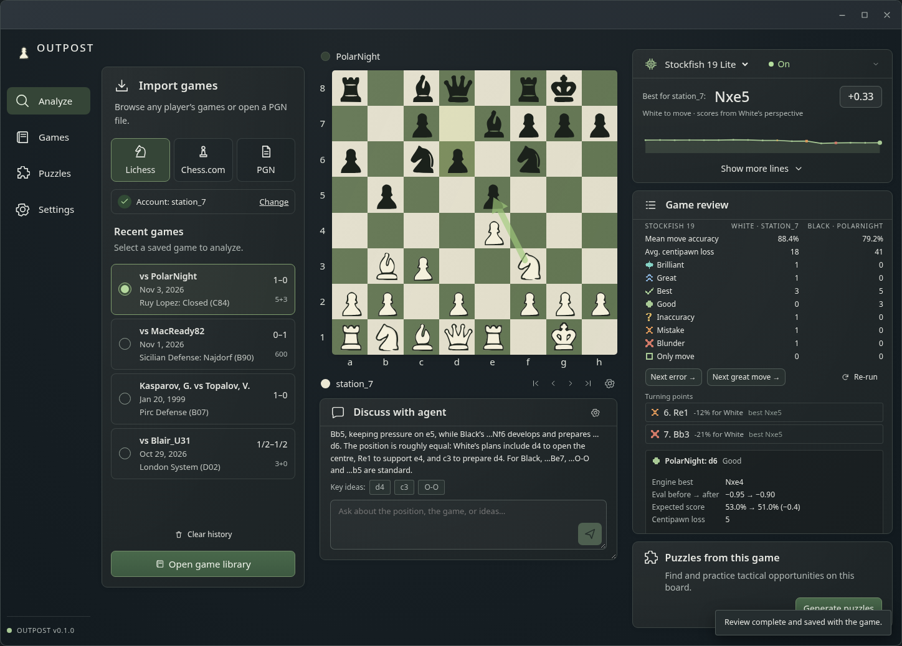
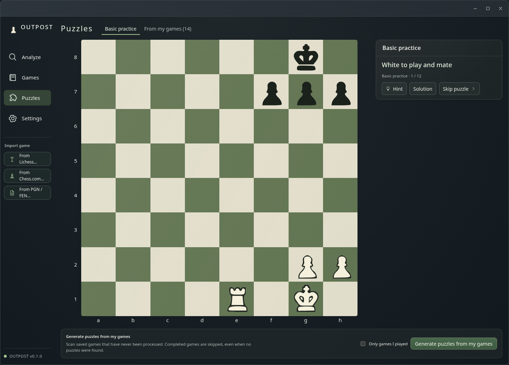

# OUTPOST

**A local chess analysis studio with a calm, focused workspace.**

Choose a game from your online history, let the built-in engine analyze it, and see why a move works, not just a number next to it. Review whole games, find the moment you lost, train on tactics generated from your own games, and, if you want, ask an AI model to explain a position. The engine and the rules stay in charge of what is true.

There is no account, no server, no subscription and no tracking. Your games, tactics and analysis stay in one folder on your machine.


<sub>Interface preview rendered with fixture data by `scripts/preview-shots.mjs`. The engine lines and classifications in the screenshots are placeholders, not real analysis.</sub>

## What it does

| | |
| --- | --- |
| **Board** | Drag-and-drop and click-to-move, legal-move dots, last move, check, all promotions, castling, en passant. Mate, stalemate, insufficient material, threefold and fifty-move detection. Flip board. Right-drag to draw arrows, right-click to circle squares (Shift/Alt/Ctrl change colour). Annotations are saved in PGN. |
| **Notation** | Variations to any depth (promote and delete), comments, NAGs. PGN and FEN import/export, clipboard, `.pgn` files with many games, drag-and-drop onto the window. |
| **Engines** | Built in: **Stockfish 19 Lite**, full Stockfish search with the small official network, in about 60 MB of memory while searching (one thread, 16 MB hash; about 5 MB idle). Add any other UCI engine (full Stockfish, Lc0, Berserk, …). On by default with one line, one thread and depth 16. More lines, infinite search and larger resource budgets are opt-in. Pausing or leaving Analyze releases the interactive engine process. Per-engine options. Global threads and hash limits. |
| **Arrows** | One best-move arrow by default; additional arrows and comparison engines are optional. Toggle with `A`, independent of your own drawings. |
| **Compare** | Run a second engine side by side. Its lines are labelled separately and keep their own scale and depth. |
| **Game review** | Every position evaluated (cached, so re-runs are fast), every move classified, accuracy and average centipawn loss per side, turning points, "next error", and an evaluation graph you can click. |
| **Classification** | Based on loss of expected score, not raw centipawns. Brilliant requires an engine-approved sacrifice found by static exchange. The rules are documented in [docs/classification.md](docs/classification.md) and adjustable. |
| **Imports** | Browse completed Lichess or Chess.com games by username and month, 20 rows per page. **Import & open** saves only the chosen game. Lichess game links also work. Existing accounts retain explicit bulk **Sync** in the library. |
| **Library** | Search, filter by source, speed, result and reviewed state, sort, favourites. Reviews are saved with each game. |
| **Puzzles** | Twelve built-in basic exercises work offline. Generate and practice current-game puzzles directly on the Analyze board. The Puzzles page also generates a collection from saved games, skipping every completed game (including zero-result scans). Cancelled or edited games remain eligible. |
| **Agent chat (optional)** | Configure your agent in Settings, then type into the scrollable chat below the board. Nothing is sent automatically. The conversation follows your game and the selected position; suggested moves are validated. |





## Install and run (Linux)

You need Rust (stable), Node.js with npm, and the WebKitGTK development stack. On Arch / Omarchy:

```sh
sudo pacman -S --needed base-devel rust nodejs npm webkit2gtk-4.1 gtk3 libsoup3
git clone https://github.com/Colton-Cogg-1999/outpost.git
cd outpost
./scripts/build
./src-tauri/target/release/outpost
```

On Debian/Ubuntu, install `libwebkit2gtk-4.1-dev libgtk-3-dev libsoup-3.0-dev librsvg2-dev` instead.

For a launcher entry without sudo:

```sh
./scripts/install-user          # ~/.local/bin/outpost + desktop file + icon
```

Or build an Arch package from the checkout: `cd pkgbuild && makepkg -si`.

`npx tauri build` also produces `.deb`, `.rpm` and AppImage bundles. OUTPOST is developed on Linux (Wayland/Hyprland). The code avoids Linux-only assumptions where it can, but Windows and macOS builds are untested.

### The built-in engine

`./scripts/build` also builds the engine (`scripts/build-engine`): Stockfish 19 from the [stockfish.js](https://github.com/nmrugg/stockfish.js) fork at a pinned commit, compiled natively for your CPU with only the small official network. The network is a pinned 1.1 MB file from the Stockfish project's server, checked by SHA-256. You need `git`, `make`, `curl` and a C++ compiler. The build takes about a minute. The engine is installed next to `outpost` as `outpost-stockfish`, and OUTPOST registers it on startup.

| | Stockfish 19 (official) | Stockfish 19 Lite (built in) |
| --- | --- | --- |
| Binary | 103 MB | 1.8 MB |
| Memory, 16 MB hash, 1 thread | ~265 MB (peak 325 MB) | about 58 MB (124 MB with 4 threads) |

The Lite network is weaker than the full one but still far beyond human strength. To use full Stockfish (or Lc0, Berserk, …), add it under **Engines** (*Detect installed engines* or *Choose executable…*) and make it the default.

### Transparency

The window is frameless, with a solid background and CRT effects off by default. You can enable translucency so your wallpaper shows through. Blur behind it is your compositor's job. On Hyprland, enable `decoration:blur` in your config. Settings has a CRT slider (0 turns scanlines and glow off), an opacity slider, and a solid-background switch for compositors without transparency.

## AI, honestly

AI is off until you choose a provider in **Settings → Agent**. Nothing is sent until you ask a question. When you do, OUTPOST sends the FEN, the moves that led there, the legal moves and simple material facts, the engine lines on screen, review facts about the move in question, player names and ratings from the PGN, and your question.

| Provider | How it authenticates |
| --- | --- |
| **Claude Code** | Your Claude subscription, through the official `claude` CLI you are already signed in to. OUTPOST never reads or stores that login. |
| **Codex (ChatGPT)** | Your ChatGPT plan, through the official `codex` CLI (`codex login`). This is the supported way to use a ChatGPT subscription from another app. A ChatGPT plan is **not** OpenAI API access, and OUTPOST does not pretend otherwise or reuse browser sessions. |
| **Anthropic / OpenAI / Gemini APIs** | API keys you paste. They are stored in your OS credential store (Secret Service, Keychain or Credential Manager), never in OUTPOST's database. Environment variables (`ANTHROPIC_API_KEY`, `OPENAI_API_KEY`, `GEMINI_API_KEY`) also work. |
| **Ollama / OpenAI-compatible** | Local models (Ollama, LM Studio, llama.cpp, vLLM…). Nothing leaves your machine. |

Agent connection, model, credentials, answer preferences and saved conversation history are managed in **Settings → Agent**.

The CLIs run with every tool disabled, in an empty folder. Engine lines given to the model are re-derived and validated first, so a model is never told an engine said something it didn't. AI answers can still be wrong. Treat them as a coach thinking aloud, and check them against the engine.

## Keyboard

| Key | Action |
| --- | --- |
| `1`–`6` | Analyze, Games, Tactics, Engines, AI, Settings |
| `←` `→` / `Home` `End` | Previous / next move, start / end |
| `↑` `↓` | Switch between variations |
| `Space` | Engine on/off |
| `A` | Engine arrows on/off |
| `F` | Flip board |
| `Ctrl+V` | Paste PGN or FEN |
| `Ctrl+S` | Save to library |
| `Ctrl+O` / `Ctrl+I` | Open file / import dialog |

You can also type moves (`Nf3`, `e2e4`) in the box under the board.

## Your data

Everything lives in `$XDG_DATA_HOME/outpost` (usually `~/.local/share/outpost`). Set `OUTPOST_DATA_DIR` to use another folder. It contains `outpost.db` (SQLite: games, reviews, cached evaluations, tactics and your training history, settings, engines and, if you enable it, AI conversations) and `outpost.log` (warnings and errors, for troubleshooting). Copy the folder while OUTPOST is closed and you have a complete backup.

Network access happens only when you start it: an import or sync, or an AI question. (Building from source also downloads the engine's pinned source and network once.)

## How it's built

Tauri 2 with a Rust backend and a React + TypeScript interface. SQLite for storage. `shakmaty` and `pgn-reader` (Rust) and `chessops` (TypeScript) for chess rules. A custom board with lightweight SVG pieces traced from the supplied dashboard reference. Asset credits are in THIRD_PARTY_NOTICES.md. Tactics come from a line-by-line port of lichess-puzzler's generator and theme tagger, checked against its own test cases. See [docs/architecture.md](docs/architecture.md) for the module map, the engine-process design (no stale results, clean shutdown), resource measurements and tradeoffs, and the security notes.

## Tests

```sh
./scripts/test                                             # uses the built-in engine for real-engine tests once built
OUTPOST_TEST_STOCKFISH=/path/to/engine ./scripts/test      # or any UCI engine
```

`OUTPOST_SELFTEST=/abs/report.txt OUTPOST_DATA_DIR=/tmp/x ./src-tauri/target/release/outpost` runs the real app with its window hidden. It drives the interface (all sections, plus account imports with `OUTPOST_SELFTEST_USER=<name>`), writes what it saw to the report, and exits.

The automated suites include Rust backend and frontend regression tests. They cover PGN parsing and normalisation, UCI parsing (scores, mate, bounds, WDL, options), engine process management against a scripted fake engine (stale-result suppression, stop, crash, illegal input, option changes), real Stockfish (MultiPV, mate in one, rapid re-requests, whole-game review, caching, cancellation), classification heuristics, static exchange evaluation, import conversion and deduplication from API fixtures, tactic generation (lichess-puzzler's tagger test cases, a scripted engine, and a real-engine game), move checking and spaced repetition, database migrations, the board (click, drag, castling, underpromotion, flipped board, arrows), the game tree (variations, repetition, PGN round trips), and screenshot recognition on synthetic boards.

## Honest limits

This is a **0.1**. It works, but:

- **Classification labels depend on review depth** (16 by default). They are heuristics; the engine numbers next to them are the facts.
- **Accuracy figures resemble Lichess's but are not identical.** OUTPOST uses a simple mean of per-move accuracy.
- **Engine comparison** puts different engines' scores side by side. Their scales and depths are not equivalent, and the interface says so.
- **Only standard chess.** Chess960 and other variants are skipped on import.
- **No live-game features**, on purpose. Imports only ever include finished games.
- **Tactics take time to find.** The current game is reviewed first (10–60 s per game; cached afterwards). *Personal* rules find roughly one tactic per two club-level blitz games. The stricter *Lichess* standard finds far fewer.
- **Windows and macOS builds are untested.** `scripts/build-engine` is written for Unix-like systems.
- **How it was tested:** automated suites, plus the self-test mode, which drives the real release binary in WebKitGTK on Arch/Hyprland (every section, live Lichess and Chess.com imports, opening a game). Layout was checked in a browser harness with mocked native calls. Please report anything that behaves differently when you use it.

## License

GPL-3.0-or-later; see [LICENSE](LICENSE). The tactic generator is ported from lichess-puzzler and stays AGPL-3.0-or-later ([licenses/AGPL-3.0.txt](licenses/AGPL-3.0.txt)). The built-in engine is Stockfish (GPL-3.0), a separate program. Fonts are under the SIL OFL. Details are in [THIRD_PARTY_NOTICES.md](THIRD_PARTY_NOTICES.md). OUTPOST is not affiliated with Lichess or Chess.com.

Contributions are welcome. See [CONTRIBUTING.md](CONTRIBUTING.md).
